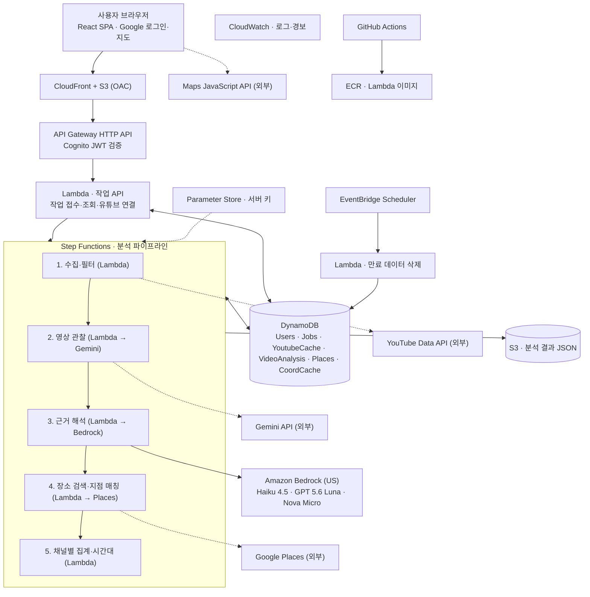
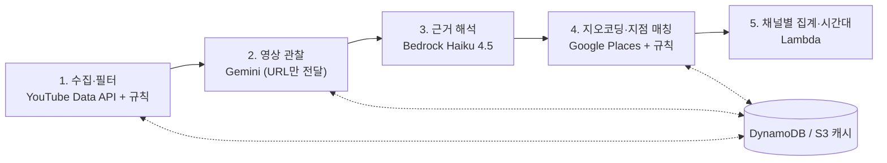

# 여행 브이로그 종합 추천 서비스 기획서

작성일: 2026년 10월 13일 · 최종 수정일: 2026년 10월 14일

## 1. 목적과 기대효과

### 목적

목적지만 입력하면 한국어 여행 브이로그를 자동으로 찾아 분석하고, 여러 채널에서 확인된 장소 방문과 평가 근거를 장소별로 모아 Google 지도와 방문 시간대 근거로 보여주는 서비스다.

**문제.** 여행 계획을 위해 브이로그를 여러 편 보고, 나온 장소를 지도에서 하나씩 검색해 저장하는 작업이 반복된다. 영상이 쌓일수록 어느 채널이 어디를 방문했는지, 어떤 평가를 했는지 정리하기 어렵다.

**타깃 사용자.** 한국어 브이로그를 참고해 해외여행을 준비하면서 영상 탐색과 장소 정리 시간을 줄이고 싶은 한국인. 여행지는 해외만 다룬다.

**서비스가 보여주는 것.** 영상에서 확인한 방문·평가 근거다. 여러 채널의 방문을 장소 품질의 객관적 검증이나 여행자 전체의 선호로 표현하지 않는다.

**과제 조건.** 2인 팀 졸업 프로젝트로, AWS Bedrock 기반 AI 기능을 포함하고 AWS 백엔드 활용 비중을 높게 가져간다. Bedrock은 US 리전에서만 쓸 수 있고, 사용 가능한 모델은 Claude Haiku 4.5, GPT 5.6 Luna, Amazon Nova Micro, Amazon Nova Lite다.

### 핵심 기능

1. **목적지 입력**: 예) "오사카", 선호 스타일은 선택
2. **영상 자동 수집**: YouTube Data API로 후보를 찾고, 서로 다른 채널의 공개 한국어 브이로그를 고른다.
3. **장소·근거 추출**: 음성, 화면 글자, 장면에서 장소 단서와 평가 근거를 타임스탬프와 함께 뽑는다.
4. **채널별 근거 종합**: 여러 채널에서 확인된 방문과 평가 근거를 장소별로 모은다. 예) "분석한 5개 채널 중 4개에서 방문 확인 · 명시적 긍정 3개 · 대기시간 불만 1개". 단순 언급은 방문으로 세지 않고, 평가가 없으면 '평가 없음'으로 둔다.
5. **지도·방문 시간대**: 장소를 Google 지도에 표시하고 지역별로 묶어 볼 수 있게 한다. 영상 속 대기·시간 언급과 장면 시간대를 모아 장소별 방문 시간대 근거를 보여준다. 예) "오픈 직후 추천 · 채널 2곳 오픈런 후 대기 짧음". 근거가 없으면 '시간 정보 없음'으로 둔다. 일자별 일정과 방문 순서는 만들지 않는다.
6. **타임스탬프 연동**: 지도 핀을 누르면 해당 장소가 나온 영상 시점으로 바로 이동한다.

**맞춤화.** 로그인 없이도 선호 스타일·동행을 고를 수 있고, 구글 로그인 후 유튜브 계정을 연결하면 구독 채널과 좋아요 누른 여행 영상을 반영한다. 영상 분석 결과는 모든 사용자가 공유하고, 영상 선택·장소 순위만 사용자마다 달라진다.

### 기대효과

- **여행 준비 시간 단축**: 브이로그 여러 편을 직접 보고 장소를 검색·저장하던 작업을 목적지 입력 하나로 대체한다.
- **근거 있는 장소 선택**: 장소마다 어느 채널이 실제로 방문했고 어떤 평가를 했는지, 근거가 나온 영상 시점과 함께 확인할 수 있다.
- **잘못된 핀 감소**: 지점 단위로 연결하고, 지점이 하나로 좁혀지지 않으면 미확정으로 표시해 엉뚱한 지점에 핀이 찍히는 일을 줄인다.
- **Bedrock 효과의 수치화**: 같은 영상 관찰 결과를 규칙 기반으로 처리한 경우와 Bedrock으로 처리한 경우를 비교해 오류 감소를 수치로 보여준다. 여러 Bedrock 모델을 같은 작업에 돌려 모델 선택의 근거도 남긴다.&#32;&#32;&#32;&#32;&#32;
- **반복 요청 비용 절감**: 한 번 분석한 영상 결과를 재사용해 같은 여행지 요청이 늘수록 영상당 비용이 줄어든다.

* **사용자 맞춤 결과**: 같은 여행지라도 사용자가 구독한 유튜버, 좋아요 누른 영상, 선호 스타일에 따라 다른 영상과 장소를 앞에 보여준다. 분석은 공유하고 순위만 개인화해 맞춤화에 드는 추가 비용이 거의 없다.

- **방문 시간 판단 도움**: 영상 속 대기·시간 언급과 장면 시간대를 모아 "오픈 직후 대기 짧음", "야경은 해 질 무렵부터"처럼 언제 가면 좋은지 근거와 함께 보여준다.

목표 수치는 첫 검증(영상 5개) 결과를 보고 최종 평가 전에 팀과 교수님이 합의해 정하며, 결과를 본 뒤 바꾸지 않는다.

### 기대효과 측정 방법

추천 결과의 만족도는 사용자 판단 영역으로 보고 측정 대상에서 제외한다.

**정답셋.** 사람이 영상을 보고 장소, 정확한 지점, 방문/언급, 평가 대상과 항목, 근거 시간 구간을 라벨링한다. 전체 전사문은 만들지 않는다. 사람에게도 지점이 불명확한 사례는 미확정 정답으로 따로 둔다. 기준 조정용 자료와 최종 평가 자료를 분리하고, Google Maps 응답을 정답으로 쓰지 않는다.

| 지표 | 측정 방법 | 비교 기준 |
| --- | --- | --- |
| 장소 단서 추출 재현율·정밀도 | 정답 장소 목록과 비교. 후보 추출과 최종 확정 결과를 구분 | 정답셋 |
| 정확한 지점 매칭률 (주지표) | 정답 장소·지점과 일치한 비율. 근처 다른 지점은 오답 | 규칙 기반 처리 vs Haiku 처리 |
| 좌표 오차 | 보조 지표 | 정답 위치 |
| 방문/언급 분류 | 클래스별 정밀도·재현율·F1 | 문자열·키워드 규칙 |
| 평가 대상 연결 정확도 | 평가가 올바른 장소에 연결된 비율 | 문자열·키워드 규칙 |
| 평가 분류 | 긍정·부정·혼합·평가 없음·판단 불가, 항목별 F1 | 문자열·키워드 규칙 |
| 검색 성공률 | 같은 지역 조건·호출 예산에서 정확한 지점을 찾은 비율 | 영상에서 추출한 원문 이름 + 도시·지역 |
| 모델 비교 | 같은 근거 해석 작업의 정확도·응답 시간·토큰 비용 | Claude Haiku 4.5 vs GPT 5.6 Luna |
| 사용자 작업 시간 | 사용자가 직접 입력·확인하는 시간 | 사람이 같은 영상을 보고 같은 수의 장소·근거를 정리하는 시간 |
| 자동 처리 대기 시간 | 요청부터 결과 완료까지 시간 | 없음 (별도 기록) |
| 비용·사용량 | 영상 1개당, 새 분석 요청당, 캐시 재사용 요청당 호출 수·토큰·비용 | 캐시 미사용 |

**핵심 실험.** 같은 Gemini 관찰 결과를 문자열·키워드 규칙으로 처리한 경우와 Haiku로 처리한 경우를 비교한다. 두 방식에 같은 지역 조건, 검색 호출 예산, 후보 매칭 규칙을 주고, Bedrock이 지점 매칭·방문 구분·평가 연결 오류를 얼마나 줄이는지 본다. 개선이 작으면 Bedrock의 역할을 다시 정한다.

**모델 비교 실험.** 근거 해석 단계를 Bedrock Converse API로 구현해 모델 ID만 바꿔 같은 프롬프트로 Claude Haiku 4.5와 GPT 5.6 Luna를 비교하고, 결과로 주력 모델을 정한다. 스타일 태그 분류는 Nova Micro와 규칙 기반 분류를 비교한다.

**시간대 근거 실험.** 정답셋에 장소별 시간 근거(시간대, 상황, 대기 언급)를 함께 라벨링하고, 같은 관찰 결과를 키워드 규칙("오픈", "웨이팅", "야경" 등)과 Haiku로 정리해 시간대 분류 정확도와 근거 연결 정확도를 비교한다.

**개인화 검증.** 취향 적합성은 객관적 정답이 없으므로, 검증 가능한 항목만 측정한다.

| 항목 | 비교·측정 |
| --- | --- |
| 영상 선정 | 같은 목적지에서 일반 검색 선정과 구독·좋아요 기반 선정을 비교하고, 사용자가 참고하고 싶은 영상인지 확인 |
| 근거 연결 | 개인화로 위에 오른 장소의 근거가 실제 영상 관찰에 연결되는지, 없는 대기·가격 정보를 만들지 않았는지 점검 |
| 캐시와 개인 데이터 분리 | 같은 분석 캐시를 서로 다른 사용자 취향에 적용해 결과가 달라지고, 다른 사용자의 작업·취향을 조회할 수 없는지 확인 |
| 재구성 비용 | 취향만 바꿨을 때 영상 재분석 없이 순위만 다시 계산되는지, 호출 수·시간 측정 |

**검색 쿼리 가설.** 영상의 한글 표기를 장소명·별칭·지점 정보로 정리하면 검색 성공률이 오른다는 것은 확인할 가설이다. Google Places는 한글 검색도 지원하고 유명 체인은 한글로도 잘 잡힐 수 있으므로, 작은 가게·줄임말·잘못 들린 이름·지점명이 있는 사례를 일부러 포함한다. 개선이 없거나 비용만 늘면 필요한 사례에만 적용한다.

**신뢰도 기준.** 모델이 출력한 신뢰도 숫자는 정답 확률로 쓰지 않는다. 첫 버전은 근거 유무와 규칙 충족 여부로 확정·미확정을 나눈다.

**보조 비교.** 제목·설명란만으로 장소를 뽑는 기준선은 YouTube 정책상 파생 분석 범위를 확인한 뒤 진행한다. 공식 자막 다운로드 API는 영상 편집 권한을 요구하므로, 자막 기준선은 제작자가 제공하거나 이용을 허락한 자막이 있을 때만 추가한다.

### 유사 서비스와 차별점

영상에서 장소를 뽑아 지도에 연결하는 서비스는 이미 여럿 있다. 조사한 범위에서는 단일 영상이나 사용자가 직접 가져온 영상을 처리하는 경우가 많았고, 본 서비스는 목적지 기반 자동 수집, 한국어 영상 관찰, 여러 채널의 방문·평가 근거 종합, 지점 단위 연결에 초점을 둔다.

| 서비스 | 형태 | 입력 | 분석 신호 | 여러 영상 종합 |
| --- | --- | --- | --- | --- |
| [VlogMap](https://chromewebstore.google.com/detail/gjojcncjnnbbpiegeaifacnbmknddohf) | 크롬 확장 | 사용자가 보는 유튜브 영상 1개 | 자막·설명란 | 저장 목록 수준 |
| [TripExtract](https://extensionauditor.com/scan/tripextract-bfchelghnmpkopkbdbfplkofkdfoonpm) | 크롬 확장 | 유튜브 영상 1개 | 자막 | 없음 |
| [GeoTok](https://peerlist.io/shalex/project/geotok--save-every-tiktok-worth-eating-at) | iOS 앱 | 사용자가 공유한 숏폼 | 캡션, 화면 OCR, 음성 전사 + 외부 검증 | 개인 지도에 누적, 후보는 사용자가 직접 선별 |
| [Tripstash](https://apps.apple.com/app/id6758553276) | iOS 앱 | 사용자가 공유한 영상·링크 | AI 장소 추출 | 저장 장소로 일정 구성 |
| [유튭콕 (숭실대, 2022)](https://koreascience.kr/article/CFKO202220859183191.pdf) | 학술대회 논문 | 유튜브 영상 정보 | 영상 메타데이터 기반 | 재생목록 단위 지도 |
| 본 서비스 | 웹 서비스 | 목적지만 입력, 영상은 자동 수집 | 음성, 화면 글자, 장소 관련 발화 + 규칙 기반 지점 매칭 | 채널별 방문·평가 근거 종합 |

표는 2026년 10월 조사 기준이며, 발표 전에 각 서비스의 현재 지원 언어와 기능을 다시 확인한다.

1. **한국어 특화**: 한국어 음성과 화면에 박힌 한글 편집 자막을 처리한다.
2. **영상 수집 자동화**: 사용자가 영상을 모을 필요 없이 목적지만 입력한다.
3. **채널별 근거 종합**: 여러 채널의 방문과 평가 근거를 장소별로 모아 보여준다.
4. **지점 단위 연결과 미확정 처리**: 지점이 하나로 좁혀진 장소만 자동 확정하고, 나머지는 미확정 후보로 표시한다.

유튭콕은 같은 문제를 다룬 국내 선례이므로 발표에서 생성형 AI 기반 관찰과 채널별 근거 종합이 추가된 점을 비교한다.

## 2. 기술 스펙

### 기술 스택

2인 팀이 AWS 안에서 끝까지 배포할 수 있는 구성으로 고른다. 프론트엔드는 정적 SPA, 백엔드는 서버리스로 둔다.

| 레이어 | 선택 | 이유 |
| --- | --- | --- |
| 프론트엔드 | React + Vite + TypeScript | 지도 중심 정적 SPA라 S3에 그대로 올라간다. 서버 렌더링이 필요 없어 Next.js는 배포만 복잡해진다 |
| 지도 | @vis.gl/react-google-maps | Maps JavaScript API용 React 래퍼 |
| 상태·통신 | TanStack Query | 분석 작업 상태 폴링과 결과 캐시 |
| 스타일 | Tailwind CSS | 별도 디자인 시스템 없이 빠르게 화면 구성 |
| 호스팅 | S3 + CloudFront | 정적 배포. S3 버킷은 비공개로 두고 CloudFront OAC로만 읽음. /api 경로는 API Gateway로 넘겨 같은 도메인에서 호출 |
| API | API Gateway (HTTP API) + Lambda | 작업 접수, 상태·결과 조회, 사용자 설정 |
| 인증 | Amazon Cognito (Google 로그인) + API Gateway JWT 인증 | 로그인은 선택. 사용자 관리와 토큰 검증을 서버 없이 처리 |
| 유튜브 연결 | Google Identity Services (OAuth 토큰) | 브라우저에서 youtube.readonly에 1회 동의. 토큰은 서버에 저장하지 않음 |
| 백엔드 언어 | Python | boto3(Bedrock), google-genai(Gemini) SDK가 성숙하고 데이터 처리가 편하다 |
| 데이터 검증 | Pydantic | AI 출력 JSON과 API 입출력 스키마 검증 |
| 파이프라인 | Step Functions (Standard) | 영상별 Map 처리, 단계별 재시도와 실행 기록 |
| 배포 단위 | Lambda 컨테이너 이미지 + ECR | 의존성 크기 여유, 로컬·CI·배포 환경 일치 |
| DB | DynamoDB (온디맨드) | 기능별 테이블 6개. 싱글 테이블 설계는 학습 비용 대비 이득이 작다 |
| 객체 저장 | S3 | 관찰·해석 결과 JSON, 집계 결과 |
| 비밀 관리 | SSM Parameter Store (SecureString) | Gemini·YouTube·Places 서버 키 |
| 정기 작업 | EventBridge Scheduler + Lambda | 만료 캐시·연결 데이터 명시적 삭제 |
| 모니터링 | CloudWatch | 오류, 처리 시간, 호출량, 삭제 실패 경보 |
| 인프라 코드 | AWS CDK (Python) | 백엔드와 같은 언어로 Step Functions까지 코드로 관리 |
| CI/CD | GitHub Actions | 테스트, 이미지 빌드·스캔, 배포 |
| 테스트 | pytest, Vitest | 백엔드·프론트 단위 테스트 |
| 로컬 개발 | Docker Compose + DynamoDB Local | 팀원 개발 환경 통일 |

### AI 모델 구성

| 모델 | 위치 | 역할 | 선택 이유 |
| --- | --- | --- | --- |
| Claude Haiku 4.5 | Bedrock (US) | 근거 해석 주력: 검색 쿼리 정리, 방문/언급 구분, 평가 대상 연결·분류, 시간 근거 정리 | 한국어 문맥 해석과 JSON 구조화 출력이 필요한 핵심 단계 |
| GPT 5.6 Luna | Bedrock (US) | 근거 해석 비교 실험 | 같은 프롬프트로 정확도·응답 시간·비용을 Haiku와 비교해 주력 모델 선택 근거로 사용 |
| Amazon Nova Micro | Bedrock (US) | 제목·설명란 기반 스타일 태그 분류 | 텍스트 전용 소형 모델이라 단순 분류에 비용·지연이 낮음 |
| Amazon Nova Lite | Bedrock (US) | 조건부 대체 모드의 업로드 영상 화면 분석 | S3 영상 입력 지원. 오디오는 분석하지 않아 Transcribe와 함께 사용 |
| Gemini (Developer API) | 외부 (Google) | 공개 유튜브 URL 관찰 | 영상 다운로드 없이 URL로 음성·화면을 관찰. 사용 허용 여부 확인 필요 |

Bedrock 호출은 Converse API로 통일해 모델 ID만 바꿔 같은 코드로 호출한다. 모델별 지원 기능과 요금은 콘솔에서 확인한다.

### 리전 구성

Bedrock은 US 리전에서만 쓸 수 있으므로 전체 스택을 US 리전 하나(예: us-east-1)에 둔다. 학교 계정에서 허용된 US 리전이 다르면 그 리전으로 맞춘다.

- Lambda와 Bedrock이 같은 리전이면 IAM 권한과 CDK 스택이 한 벌로 끝난다. 서울에 두고 US Bedrock을 교차 호출하면 리전 두 개를 관리해야 한다.
- 분석은 비동기 작업이라 한국과 미국 사이 왕복 지연은 체감에 거의 영향이 없고, 정적 파일은 CloudFront 엣지에서 내려간다.
- 첫 버전은 로그인과 개인정보 저장이 없어 데이터 위치로 인한 제약이 작다.
- 모델에 따라 교차 리전 추론 프로파일(us. 접두사)로 호출해야 할 수 있으므로 첫 검증에서 확인한다.

### 외부 API와 한도

| 서비스 | 조건 | 관리 방식 |
| --- | --- | --- |
| Amazon Bedrock | US 리전만 사용. 학교 계정의 모델 접근·IAM 권한 필요 | 항목별 짧은 출력, 호출 횟수 제한 |
| Gemini Developer API | 무료 티어에서 유튜브 영상 하루 8시간. 프로젝트·모델별 분당 요청, 분당 토큰, 일일 요청 한도가 따로 있음 | 분석한 영상 재사용, 예약 동시성으로 전체 호출 수 제한, 시연 도시 사전 처리 |
| YouTube Data API (검색) | 기본 검색 하루 100회, 기타 엔드포인트 합산 하루 10,000단위 | 검색어·정렬·페이지별 호출을 합산 관리, 목적지별 결과 재사용 |
| YouTube Data API (사용자 연결) | OAuth youtube.readonly는 민감 권한. 테스트 모드에서는 등록한 테스트 사용자 100명까지 검수 없이 사용 | 연결할 때 1회 조회, 토큰 미저장, 비용이 낮은 목록 API만 사용 |
| Places·Maps | API별 활성화와 결제 계정 필요. SKU별 무료 사용량 | 필요한 필드만 요청, API별 사용량 상한 설정 |
| Google AI Plus 학생 혜택 | 앱 구독 혜택이며 API 결제와 별개 | 개발용 API 운영비로 가정하지 않음 |

결제 알림만으로 호출이 멈춘다고 가정하지 않고, 서버에 요청당 영상 수·재시도 횟수·검색 횟수 상한을 둔다. 무료 한도와 가격은 바뀔 수 있으므로 구현 시작과 시연 전에 다시 확인한다.

## 3. 아키텍처

### 전체 구성

사용자 요청은 CloudFront와 API Gateway를 거쳐 Lambda로 들어오고, 실제 분석은 Step Functions 파이프라인이 비동기로 처리한다. 영상 관찰은 Gemini, 근거 해석은 Bedrock, 수집·매칭·저장은 AWS 인프라가 맡는다.


*전체 아키텍처 · AWS us-east-1 단일 리전 (점선 = AWS 밖 외부 서비스)*

- **프론트**: CloudFront가 S3의 정적 웹을 내려주고, /api 경로는 API Gateway로 넘긴다. 지도는 브라우저가 Maps JavaScript API를 직접 불러 그린다.
- **작업 API**: Lambda가 작업을 접수해 Jobs 테이블에 기록하고 Step Functions를 시작한다. 상태 조회도 같은 Lambda가 Jobs를 읽어 답한다.
- **분석 파이프라인**: Step Functions가 5단계 Lambda를 순서대로 실행하고 재시도·실패를 관리한다. 외부 API 호출은 각 단계 Lambda가 맡는다.
- **저장**: 작은 상태와 인덱스는 DynamoDB, 큰 관찰·해석 결과는 S3에 둔다.
- **운영**: 서버 키는 Parameter Store, 로그·지표·경보는 CloudWatch, 만료 데이터 삭제는 EventBridge Scheduler가 매일 실행한다. Lambda 이미지는 ECR에 저장하고 GitHub Actions가 빌드·배포한다.

**인증·맞춤화.** 로그인은 선택이다. Cognito가 Google 로그인을 처리하고 API Gateway가 JWT를 검증한다. 유튜브 연결은 로그인과 별도로 사용자가 동의할 때만 진행하고, 사용자 테이블에는 연결 시점의 선호 정보만 남긴다.

### 요청 흐름

1. 프론트가 요청 ID(UUID)를 만들어 `작업 접수 API`로 목적지, 선호 입력과 함께 보낸다. 비로그인 사용자는 /public/jobs로, 로그인 사용자는 Cognito 토큰과 함께 /jobs로 보내며 API Gateway가 /jobs의 JWT를 검증한다.
2. Lambda가 요청 ID를 jobId로 써서 Jobs에 조건부로 기록한다. 같은 요청이 두 번 와도 작업은 하나만 생긴다. 비로그인 작업은 guestAccessToken을 한 번 반환하고 해시만 저장한다. Step Functions 실행 이름은 jobId로 해 시작 실패 시 안전하게 재시도한다. 그다음 Step Functions를 시작한다.
3. 프론트는 `GET /jobs/{id}`를 몇 초마다 조회해 진행률을 보여준다. 첫 버전은 웹소켓 없이 폴링한다.
4. 상태가 SUCCEEDED·PARTIAL·FAILED가 되면 폴링을 멈추고 결과를 지도에 표시한다. 최대 대기 시간을 넘기면 안내 문구를 보여준다.

### API와 접근 제어

| API | 인증 | 역할 |
| --- | --- | --- |
| `POST /public/jobs` | 없음 (요청 제한·전역 호출 예산 적용) | 비로그인 분석 작업 접수. jobId와 guestAccessToken 반환 |
| `GET /public/jobs/{id}` | guestAccessToken (헤더) | 비로그인 작업 상태·결과 조회 |
| `POST /jobs` | Cognito JWT | 로그인 분석 작업 접수 |
| `GET /jobs/{id}` | Cognito JWT + 소유자 | 진행 상태·부분 성공·결과 조회 |
| `POST /jobs/{id}/rerank` | Cognito JWT + 소유자 | 선호를 바꿔 순위만 규칙으로 다시 계산. 영상 재분석·모델 호출 없음 |
| `GET/PATCH /me/preferences` | Cognito JWT | 내 선호 스타일·동행·참고 채널 조회·수정 |
| `POST /me/youtube/import` | Cognito JWT + 요청 중 Google 토큰 | 구독·좋아요 1회 조회 후 취향 후보 반환. 토큰은 저장·로깅 안 함 |
| `DELETE /me/youtube/connection` | Cognito JWT | 연결 해제, 연결 데이터 즉시 삭제 |

**경로 분리.** HTTP API의 JWT 인증은 경로 단위로 켜고 끄는 방식이라 "토큰이 있으면 검증, 없으면 통과"를 할 수 없다. 그래서 비로그인 `/public/*`과 로그인 `/jobs`, `/me/*`를 분리한다.

**소유자 확인.** 로그인 사용자는 검증된 JWT의 sub로만 정하고 요청 본문의 userId는 믿지 않는다. Jobs의 userId와 sub가 같을 때만 조회·재계산할 수 있다.

**비로그인 접근 토큰.** jobId는 URL·로그에 노출되기 쉬워 권한 키로 쓰지 않는다. 작업 접수 때 무작위 guestAccessToken(256비트)을 한 번만 반환하고, Jobs에는 SHA-256 해시(guestAccessHash)만 저장한다. 조회 때는 헤더로 받은 토큰을 해시해 비교한다. 비로그인 결과에는 개인 데이터를 담지 않는다. 결과 파일은 공개 프론트 버킷과 분리하고 API를 거쳐서만 제공하며, CloudFront의 `/api/*`는 캐시하지 않는다.

### 분석 파이프라인

요청 하나는 수집, 관찰, 해석, 매칭, 집계 순서로 진행한다. 단계 사이에는 영상 ID·상태·S3 키만 넘기고, 큰 결과는 S3에서 읽는다.


*분석 파이프라인 5단계와 캐시*

1. **검색 캐시 확인**: 목적지·검색어·정렬·페이지 조건에 맞는 유효한 검색 결과가 있으면 재사용한다. 없으면 여러 검색어로 YouTube Data API를 호출한다. 유튜브를 연결한 사용자는 구독 채널의 업로드 목록과 좋아요·재생목록 영상 중 목적지 관련 영상을 후보 앞쪽에 넣는다.
2. **후보 필터링**: 영상 ID 중복, 공개 여부, 길이, 업로드일, 채널 상한은 규칙으로 처리한다. 재업로드는 의심 후보로 표시만 하고 확정하거나 제외하지 않는다. 스타일 태그만 Nova Micro로 보조 분류한다.
3. **영상 관찰 (Gemini)**: 분석된 적 없는 영상만 URL로 넘기고, 판단 없이 관찰 근거만 받아 S3에 저장한다.
   - 시간 구간: 시작·종료 시각. 정확한 시각을 확신할 수 없으면 구간으로 기록
   - 들린 장소명, 화면에 보인 장소명(간판, 편집 자막, 메뉴판)
   - 평가 근거: 장소 주변의 맛·가격·대기·서비스 관련 발화나 편집 자막 원문, 시간 언급(오픈 직후, 점심 피크, 일몰 등)
   - 단서 종류: 음성 / 화면 글자 / 장면
   - 실제 방문을 보여주는 장면 한 줄과 장면 시간대(낮·밤 등)
   - 불확실성: 잘 안 들림, 글자 불명확, 평가 대상 모호 등
   - 들리지 않거나 읽히지 않는 이름·평가는 추측해 채우지 않는다
4. **근거 해석 (Bedrock)**: Haiku 4.5가 S3의 관찰 결과를 읽어 정리하고, 결과를 다시 S3에 저장한다.
   - 장소명·별칭·지점 정보를 정리해 검색 쿼리를 만든다. 서로 다른 지점은 합치지 않고, 불명확하면 원문을 유지해 미확정으로 둔다
   - 실제 방문, 단순 언급, 불명확을 구분하고 근거 관찰을 연결한다
   - 평가가 어느 장소에 대한 것인지 연결한다. 대상이 모호하면 미확정으로 둔다
   - 평가를 긍정·부정·혼합·평가 없음·판단 불가로 분류하고 맛·가격·대기 등 항목을 따로 기록한다. "맛은 긍정, 대기는 부정"처럼 항목별 평가는 함께 남긴다. 시간 근거는 오전·점심·오후·저녁·밤 같은 시간대와 오픈 직후·피크 회피·일몰 같은 상황으로 정리한다. 근거 종류(장면 관찰·방문 시각 언급·대기 경험·제작자 추천)를 함께 기록하고, 영상 재생 위치를 방문 시각으로 쓰지 않는다
5. **장소 검색**: Google Places로 후보 장소를 검색한다. Places 결과는 Bedrock에 넘기지 않고 일반 코드가 처리한다. 금지가 확인된 것은 아니지만 데이터 흐름을 단순하게 하기 위한 설계 선택이다.
6. **지점 매칭**: 이름·별칭과 지역·지점 단서를 규칙으로 대조한다.
   - 거리 조건은 영상에서 위치 단서가 확인됐을 때만 쓴다
   - 검색 결과 상위에 나왔다는 이유만으로 확정하지 않는다
   - 같은 체인의 다른 지점은 별도 장소로 유지한다
   - 후보가 여러 개 남으면 미확정으로 둔다
   - 확정 기준은 조정용 라벨링 자료로 정하고, 별도 평가 자료로 검증한다
7. **채널별 집계**: 집계 범위는 이번 작업에 포함된 영상뿐이며, 캐시에 있는 다른 영상은 분모에 더하지 않는다. 장소 ID로 같은 지점을 합치고 채널 단위로 방문·평가 근거를 센다. 같은 채널 안에서 평가가 엇갈리면 혼합으로 남긴다. 긍정 비율을 보여줄 때는 분모와 혼합·평가 없음 처리 기준을 함께 표시한다. 분석에 실패한 영상의 채널은 '방문 안 함'으로 세지 않고 분모에서 뺀다("분석 성공 4개 채널 중"). 조회수·좋아요·구독자 수·업로드일은 점수에 쓰지 않는다. 사용자별 순위는 이 공유 집계 위에서 따로 계산한다(아래 맞춤화 참고).
8. **방문 시간대 정리**: 장소별로 채널들의 시간 근거를 모아 아래 규칙으로 방문 시간대 근거를 만든다.
9. **출력**: 결과 JSON을 S3에 저장하고 Jobs에 S3 키를 기록한다. 프론트는 이를 받아 핀, 채널별 근거, 방문 시간대 근거, 영상 타임스탬프 링크를 표시한다.

### 데이터 흐름과 정제

②\~⑤의 분석 결과는 모든 사용자가 공유하고, ⓪·①·⑥만 사용자마다 달라진다. 로그인하지 않은 사용자는 ⓪을 건너뛰고 일반 검색과 화면에서 고른 선호만 쓴다.

| 단계 | 입력 | 처리 주체 | 정제 처리 | 출력 | 저장 위치 |
| --- | --- | --- | --- | --- | --- |
| ⓪ 취향 수집 | 구독 채널, 좋아요 영상, 재생목록 | Lambda + Nova Micro | 제목·설명란으로 여행 영상만 남김. 여행 영상을 올린 채널만 남김. 스타일 태그 비율 후보 계산 후 사용자 확인·수정. OAuth 토큰은 저장하지 않음 | 여행 구독 채널, 여행 좋아요 영상, 취향 비율 | Users (30일마다 재연결) |
| ① 영상 수집 | 목적지, ⓪ 결과, 검색 결과 | Lambda (규칙) | 좋아요·재생목록과 구독 채널 업로드 중 목적지 영상을 먼저 넣고, 부족분은 취향 비율에 맞춰 일반 검색으로 채움. 같은 영상 제거, 채널당 1개, 짧은 영상·비공개 제외, 재업로드는 의심 표시만 | 서로 다른 채널 5개 영상 | YoutubeCache (30일), Jobs |
| ② 관찰 | 영상 URL | Gemini | 판단 없이 들린 말·보인 글자·장면·시간 언급만 기록. 안 들리거나 안 읽히면 추측하지 않고 불확실성 표시 | 시간 구간별 장소 단서, 평가·시간 발화 원문 | S3 + VideoAnalysis (공유) |
| ③ 해석 | ② 관찰 결과 | Bedrock (Haiku 4.5) + Pydantic | 같은 장소의 여러 표기 묶기. 방문과 단순 언급 구분. 평가를 맞는 장소에 연결하고 항목별 분류. 시간 근거를 시간대·상황 범주로 정리. 형식 오류는 재요청, 두 번 실패하면 그 영상만 실패 | 장소 후보, 검색 쿼리, 방문 여부, 항목별 평가, 시간 근거 | S3 + VideoAnalysis (공유) |
| ④ 매칭 | ③ 검색 쿼리 | Lambda + Google Places | 지역·지점 단서로 대조. 여러 개 남으면 미확정. 체인 지점은 따로 유지. Google 응답의 이름·주소는 저장하지 않음 | 확정 placeId 또는 미확정 후보 | Places, CoordCache (25일) |
| ⑤ 집계 | 확정 장소 + 근거 | Lambda (규칙) | placeId로 합치기. 한 채널은 1표. 언급은 방문 아님. 평가 없는 방문은 긍정 아님. 실패한 채널은 분모에서 제외. 시간 근거는 채널 수와 함께 묶음 | "5개 채널 중 4개 방문 · 긍정 3 · 대기 불만 1", "오픈 직후 추천 · 채널 2곳" | Places 근거 아이템 (공유) |
| ⑥ 맞춤 순위 | ⑤ 집계 + 사용자 취향 | Lambda (규칙) | 구독 채널이 방문한 장소, 취향 스타일 장소에 가중치. 지역별로 묶어 보기 제공 | 사용자별 장소 순위 | S3 결과 JSON, Jobs |

### 안정성 설계

- **Gemini 호출 한도**: Map의 최대 동시 실행 수는 작업 하나 안의 병렬 수만 제한하므로, 여러 사용자의 작업이 겹치면 전체 호출이 늘어난다. 관찰 Lambda에 예약 동시성(예: 2)을 걸어 모든 작업을 통틀어 Gemini 동시 호출 수를 고정하고, 한도에 걸린 호출과 429 응답은 Step Functions 재시도(지수 백오프)로 기다렸다 다시 보낸다. 분당 토큰 한도는 첫 검증에서 영상당 토큰 사용량을 재고 동시성 값을 정한다. 첫 검증은 순차 처리로 시작한다.
- **실행 시간 제한**: Lambda는 최대 15분까지 실행된다. 관찰 Lambda는 영상 1개만 처리하고, SDK 요청 타임아웃 < Lambda 타임아웃 < Step Functions 작업 타임아웃 순서로 맞춘다. 첫 호출에서 실제 소요 시간을 기록한다.
- **페이로드 크기**: Step Functions 입출력은 256 KiB로 제한되므로 결과는 S3에 두고, 단계 사이에는 영상 ID·상태·S3 키만 전달한다.
- **부분 실패**: 영상별 처리 안에서 오류를 잡아 실패 상태로 기록하고, 성공한 영상으로 집계를 진행한다. Jobs 상태는 PARTIAL로 두고 화면에 "4개 채널 분석 완료 · 1개 영상 분석 실패"처럼 표시한다.
- **중복 방지**: 작업은 요청 ID를 jobId로 쓰는 조건부 쓰기로 한 번만 만든다. 영상 분석은 VideoAnalysis에 조건부 업데이트로 "분석 중" 상태를 먼저 선점해 같은 영상을 동시에 두 번 분석하지 않는다. 일정 시간이 지난 선점은 만료로 보고 다시 잡을 수 있게 한다. 다른 작업이 같은 영상을 분석 중이면 Gemini를 다시 호출하지 않고, Step Functions가 일정 간격으로 상태를 확인해 끝난 결과를 재사용한다.
- **AI 출력 검증**: Gemini와 Bedrock의 출력 JSON을 Pydantic 스키마로 검증한다. 형식이 틀리면 한 번 다시 요청하고, 그래도 실패하면 해당 영상을 실패로 기록한다.

### 영상 수집 및 중복 제거 전략

서로 다른 채널의 영상을 고르게 모으고, 같은 영상이나 같은 채널이 결과를 독점하지 않게 한다. 서로 다른 채널이 같은 장소를 방문한 영상은 중복이 아니라 집계에 필요한 자료이므로, 장소가 겹친다는 이유로 영상을 거르거나 뒤로 미루지 않는다.

| 대상 | 첫 버전 처리 | 사용 데이터 |
| --- | --- | --- |
| 같은 영상 ID | 중복 제거 | 검색 결과 |
| 같은 채널의 여러 영상 | 채널당 1개 선별 | 채널 ID |
| 같은 여행의 시리즈물 | 여행 단위 식별은 구현하지 않고 채널 단위로 집계 | 채널 ID |
| 짧은 영상 | 첫 실험의 길이 조건으로 제외. 길이만으로 쇼츠라고 단정하지 않음 | 길이 |
| 재업로드·짜깁기 | 제목 유사도가 높고 길이가 거의 같은데 채널이 다르면 의심 후보로 표시. 확정·제외하지 않음 | 제목, 길이 |
| 서로 다른 채널의 장소 겹침 | 제외·후순위 기준으로 쓰지 않음 | 없음 |
| 여행 스타일 편중 | 채널 상한과 함께 쓰는 보조 기준 | 제목, 설명란 |

**집계 원칙.** 세는 단위는 채널이다. 한 채널이 여러 편에서 같은 장소를 다뤄도 1개 채널로 센다. 단순 언급은 방문으로 세지 않는다. 화면에는 "분석한 5개 채널 중 4개에서 방문 확인"처럼 분석한 표본 수를 함께 표시한다.

**스타일 다양화.** 카페·포토스팟 위주 영상처럼 한 가지 성향의 영상만으로 표본이 채워지지 않게 한다. 기준은 유튜버의 성별이나 나이가 아니라 영상이 다루는 장소 유형이다.

- 스타일 예시: 맛집, 카페·포토스팟, 관광·역사, 쇼핑, 가성비
- Nova Micro가 제목·설명란만 보고 태그를 붙인다. 하나로 정하기 어려우면 복합 또는 분류 불가로 둔다.
- 서로 다른 채널 수 확보가 우선이며, 자료가 부족하면 비율을 억지로 맞추지 않는다.
- YouTube 메타데이터를 분류에 쓰는 범위는 정책 확인 사항으로 남긴다.

**수집 단계 보완.**

- 검색어를 섞는다. 예) "오사카 브이로그", "오사카 맛집", "오사카 3박4일"
- 최근 1\~2년 영상으로 제한한다. 다만 업로드일이 실제 촬영일이나 현재 영업을 보장하지는 않는다.
- 조회수순과 최신순 결과를 섞어 후보를 만든다. 조회수는 검색 정렬에만 쓴다.
- 설명란에 제작자가 적은 타임스탬프는 파싱할 수 있지만, 자동 챕터가 API의 별도 필드로 온다고 가정하지 않는다.

### 방문 시간대 근거 규칙

시간 근거는 종류별로 나눠 기록하고, 종류가 다른 근거를 서로 바꾸어 표현하지 않는다.

| 근거 종류 (kind) | 예시 | 화면 표현 |
| --- | --- | --- |
| 장면 관찰 (SCENE) | 야간 장면에서 방문 | "영상 속 밤 방문 장면". 밤 방문 추천으로 바꾸지 않음 |
| 방문 시각 언급 (STATED\_TIME) | "아침 9시에 왔어요" | 원문과 출처를 함께 표시. 현지 시각(localClockTime)은 이 경우에만 기록 |
| 대기 경험 (WAIT\_EXPERIENCE) | "오픈 직후라 줄 거의 없었어요", "점심에 40분 기다렸어요" | "영상 속 경험"으로 표시 |
| 제작자 추천 (CREATOR\_TIP) | "여긴 꼭 오픈 직후에 가세요" | 추천 주체(채널)와 영상 근거를 함께 표시 |

1. "추천" 문구는 제작자 추천(CREATOR\_TIP)이 있거나, 같은 상황의 대기 경험이 채널 2곳 이상에서 같은 방향일 때만 쓴다. 장면 관찰만으로는 추천하지 않는다.
2. 같은 상황을 언급한 채널 수는 채널당 한 번 센다.
3. 채널끼리 엇갈리면 "점심 대기 40분(1곳) · 오픈 직후 대기 짧음(2곳)"처럼 그대로 나열한다.
4. 영상 재생 위치(videoTimeRange, 초 단위)는 근거가 나온 지점일 뿐 방문 시각이 아니다. 방문 시각·시간대는 visitTimeEvidence에 따로 저장하고, 근거가 없으면 null로 둔다.
5. 시간 근거가 없으면 "시간 정보 없음"으로 두고 낮·밤 장면이나 재생 위치로 추측하지 않는다.
6. 영업시간은 핀을 눌렀을 때 Google Places 상세 정보로 화면에만 띄우고 저장하지 않는다. 구글 지도의 혼잡 시간대 그래프는 쓰지 않는다.
7. 촬영일·계절이 확인되지 않은 자료이므로 화면 표현은 "영상 속 방문 경험"으로 하고, 오늘의 혼잡 예측처럼 단정하지 않는다.

### 맞춤화

유튜브 추천 알고리즘이나 시청 기록은 공식 API로 받을 수 없고, Gemini도 사용자 유튜브 계정에 접근하지 못한다. 대신 사용자가 직접 고른 선호와, 동의를 받아 가져온 구독 채널·좋아요 영상으로 맞춤화한다.

| 층 | 내용 | 공유 여부 |
| --- | --- | --- |
| 분석 층 | 영상 1개의 관찰·해석 결과, 장소별 채널 근거 | 모든 사용자가 공유 (캐시로 비용 절감) |
| 맞춤 층 | 분석할 영상 선택, 장소 순위 | 사용자마다 계산 |

**맞춤화 입력.**

| 입력 | 얻는 방법 | 반영 위치 |
| --- | --- | --- |
| 선호 스타일 (맛집, 카페, 관광, 쇼핑 등) | 화면에서 선택. 로그인 불필요 | 영상 스타일 비율, 장소 순위 |
| 동행 (혼자·커플·가족) | 화면에서 선택. 로그인 불필요 | 장소 유형 가중치 |
| 구독 채널 | YouTube 연결 후 subscriptions.list(mine) | 해당 채널의 목적지 영상을 수집 우선순위 앞에 둠, 그 채널이 방문한 장소에 가중치 |
| 좋아요·재생목록 영상 | YouTube 연결 후 videos.list(myRating=like), playlists.list(mine) | 목적지 관련 영상은 바로 분석 대상에 포함, 여행 영상의 스타일 태그로 선호 스타일 추정 |

**유튜브 연결 흐름.**

1. 사용자가 Google 로그인(Cognito) 후 "유튜브 연결"을 누른다.
2. 브라우저가 Google Identity Services로 youtube.readonly 권한에 동의를 받아 짧은 수명의 액세스 토큰을 받는다.
3. 토큰을 연결 API(Lambda)에 한 번 보내면, Lambda가 구독 채널·좋아요 영상·재생목록을 조회해 여행 관련 채널·영상과 스타일 비율 후보를 돌려준다. 사용자가 참고할 채널과 취향을 확인·수정하면 Users 테이블에 저장한다. YouTube 정책상 자동 취향 추정의 이용 범위가 확인되기 전에는 추정 비율을 쓰지 않고, 사용자가 목록에서 채널과 스타일을 직접 고른다.
4. 토큰은 저장하지 않는다. 갱신 토큰을 보관하지 않으므로 별도 암호화 키 관리가 필요 없고, 다시 반영하려면 사용자가 다시 연결한다.
5. 연결 해제를 누르면 연결로 얻은 데이터를 즉시 삭제하고 Google 권한도 해제한다.

**토큰을 저장하지 않는 이유.** refresh 토큰을 서버에 보관하면 자동 갱신은 가능하지만 KMS 암호화, 갱신 실패 처리, 유출 대응, OAuth 콜백의 state 검증까지 구현해야 한다. 취향은 자주 바뀌지 않으므로 첫 버전은 1회 조회와 30일 재연결로 충분하다고 보고, 자동 갱신은 향후 확장으로 둔다.

**취향 변경.** 선호만 바꾸면 `POST /jobs/{id}/personalize`로 기존 분석 결과의 순위만 다시 계산한다. 참고 채널을 바꿔 새 영상이 선정되면 그 영상만 추가 분석한다.

**비용 관리.** 구독 채널의 영상은 채널 검색(호출당 100단위) 대신 채널 업로드 재생목록 조회(1단위)로 가져와 제목으로 목적지 영상을 거른다. 맞춤 순위는 공유 분석 결과를 다시 정렬하는 계산이라 모델 호출이 늘지 않는다.

**단계.** 첫 검증(영상 5개 파이프라인)에서는 비로그인 선호 입력만 구현하고, 유튜브 연결은 그다음 단계에 추가한다.

## 4. DB 설계 (DynamoDB)

DynamoDB는 스키마가 없어 아이템을 JSON 문서로 저장한다. 아래 ERD는 테이블 사이의 키 참조를 보여주는 논리 구조이며, 조인은 애플리케이션 코드에서 처리한다.

```mermaid
erDiagram
    Users ||--o{ Jobs : "userId (로그인 시)"
    Jobs }o--o{ VideoAnalysis : "videoRefs (N:M)"
    VideoAnalysis ||--o{ Places : "videoId-index (근거 아이템)"
    YoutubeCache }o--o{ VideoAnalysis : "영상 ID"
    Places ||--o| CoordCache : "placeId (임시)"
    Users {
        string userId PK "Cognito sub"
        map preferences
        bool youtubeLinked
        list subscribedChannelIds
        list likedTravelVideoIds
        map styleProfile
        string syncedAt
    }
    Jobs {
        string jobId PK
        string userId "선택"
        string status
        map request "목적지·선호"
        list videoRefs "videoId·analysisVersion"
        string guestAccessHash "비로그인 시"
        map progress
        string resultS3Key
    }
    VideoAnalysis {
        string videoId PK
        string analysisVersion SK
        string status
        string lockOwner
        string channelId
        string styleTag
        string observationS3Key
        string interpretationS3Key
    }
    Places {
        string placeId PK
        string sk SK "PLACE | EVID#채널#영상#시각"
        string videoId "GSI videoId-index"
        string extractedName
        string visitStatus
        map ratings
        string analysisVersion
        map videoTimeRange "재생 위치(초)"
        map visitTimeEvidence
        string evidenceText
    }
    YoutubeCache {
        string pk PK "SEARCH#… | VIDEO#…"
        string sk SK "RESULT | META"
        list videoIds
        number expiresAt "TTL"
    }
    CoordCache {
        string placeId PK
        number lat
        number lng
        string fetchedAt
        number expiresAt "TTL"
    }
```
*DynamoDB 논리 ERD · 테이블 6개 (조인 없음, 키 참조만)*

### 테이블 구성

| 테이블 | 파티션 키 | 정렬 키 | 보조 인덱스 | 용도 | 보존 |
| --- | --- | --- | --- | --- | --- |
| Users | userId (Cognito sub) | 없음 | 없음 | 선호 입력, 유튜브 연결로 얻은 구독 채널·좋아요 여행 영상·스타일 프로필 | 연결 데이터는 연결 해제 시 즉시 삭제, 30일마다 재연결 요청 |
| Jobs | jobId | 없음 | 없음 | 분석 작업 상태·진행률·결과 위치, videoRefs(영상·분석 버전), 로그인 시 userId 또는 비로그인 시 guestAccessHash | 성과 측정용으로 보존 |
| YoutubeCache | pk (SEARCH#… / VIDEO#…) | sk (RESULT / META) | 없음 | 검색 결과와 영상 공개 메타데이터 | 30일 이내 갱신·삭제 |
| VideoAnalysis | videoId | analysisVersion | 없음 | 영상별 분석 상태·선점·결과 위치 | 영상이 비공개·삭제되면 삭제 |
| Places | placeId | sk (PLACE / EVID#채널#영상#분석버전#시작초) | videoId-index (videoId, placeId) | 장소 아이템과 채널별 방문·평가 근거 | 장소 ID는 계속 저장, Google 응답 필드는 저장 안 함 |
| CoordCache | placeId | 없음 | 없음 | Google 좌표 임시 캐시 | 25일 만료, 30일 전 명시적 삭제 |

### 아이템 예시 (JSON)

값은 예시다. 시각은 ISO 8601, TTL 속성(expiresAt)은 DynamoDB TTL 규칙에 맞춰 유닉스 초로 저장한다.

**Jobs**

```json
{
  "jobId": "a1b2c3d4-5e6f-4a7b-8c9d-0e1f2a3b4c5d",
  "requestId": "req-7f3c",
  "userId": "cognito-sub-1234",
  "status": "PARTIAL",
  "request": { "destination": "오사카", "styles": ["맛집"], "companion": "커플" },
  "videoRefs": [
    { "videoId": "vid_A", "analysisVersion": "v1-haiku45" },
    { "videoId": "vid_B", "analysisVersion": "v1-haiku45" }
  ],
  "progress": { "total": 5, "analyzed": 4, "failed": 1 },
  "executionArn": "arn:aws:states:us-east-1:<계정ID>:execution:analyze:a1b2c3d4",
  "resultS3Key": "results/a1b2c3d4/result.json",
  "metrics": { "elapsedSec": 312, "geminiTokens": 184000, "bedrockInputTokens": 15600, "bedrockOutputTokens": 3300 },
  "createdAt": "2026-10-20T09:00:00Z",
  "updatedAt": "2026-10-20T09:05:12Z"
}
```

비로그인 작업은 userId 대신 guestAccessHash를 저장하고 원문 토큰은 저장하지 않는다. analysisVersion은 모델·프롬프트·출력 스키마 조합을 나타낸다(예: v1-haiku45, v1-luna56).

**YoutubeCache** (검색 결과 아이템과 영상 메타데이터 아이템)

```json
{
  "pk": "SEARCH#오사카#오사카 브이로그#viewCount#p1",
  "sk": "RESULT",
  "videoIds": ["vid_A", "vid_B", "vid_F"],
  "fetchedAt": "2026-10-20T09:00:03Z",
  "expiresAt": 1795078803
}
```

```json
{
  "pk": "VIDEO#vid_A",
  "sk": "META",
  "channelId": "ch_01",
  "title": "오사카 3박4일 먹방 브이로그",
  "durationSec": 1435,
  "publishedAt": "2026-03-02T11:00:00Z",
  "privacyStatus": "public",
  "fetchedAt": "2026-10-20T09:00:04Z",
  "expiresAt": 1795078804
}
```

**VideoAnalysis**

```json
{
  "videoId": "vid_A",
  "analysisVersion": "v1",
  "status": "DONE",
  "lockOwner": "a1b2c3d4-5e6f-4a7b-8c9d-0e1f2a3b4c5d",
  "lockedAt": "2026-10-20T09:00:10Z",
  "channelId": "ch_01",
  "styleTag": "맛집",
  "observationS3Key": "analysis/vid_A/v1/observation.json",
  "interpretationS3Key": "analysis/vid_A/v1/interpretation.json",
  "models": { "observer": "gemini", "interpreter": "claude-haiku-4.5", "styleTagger": "nova-micro" },
  "usage": { "geminiTokens": 41200, "bedrockInputTokens": 3900, "bedrockOutputTokens": 820 },
  "analyzedAt": "2026-10-20T09:02:41Z",
  "lastCheckedAt": "2026-10-20T09:00:05Z"
}
```

**Places** (장소 아이템과 근거 아이템)

```json
{
  "placeId": "ChIJ_example_place_id",
  "sk": "PLACE",
  "destination": "오사카",
  "extractedName": "이치란 도톤보리점",
  "aliases": ["이치란", "一蘭 道頓堀店"],
  "categoryFromVideo": "식당"
}
```

```json
{
  "placeId": "ChIJ_example_place_id",
  "sk": "EVID#ch_01#vid_A#v1-haiku45#750",
  "videoId": "vid_A",
  "evidenceKey": "ChIJ_example_place_id#v1-haiku45#750",
  "analysisVersion": "v1-haiku45",
  "channelId": "ch_01",
  "visitStatus": "VISITED",
  "matchStatus": "CONFIRMED",
  "videoTimeRange": { "startSec": 750, "endSec": 905 },
  "clueTypes": ["SPEECH", "SCREEN_TEXT"],
  "ratings": { "overall": "MIXED", "taste": "POSITIVE", "wait": "NEGATIVE", "price": "NONE" },
  "evidenceText": "국물 진짜 맛있는데 40분 기다린 건 좀...",
  "visitTimeEvidence": {
    "kind": "WAIT_EXPERIENCE",
    "situation": "LUNCH_PEAK",
    "localClockTime": null,
    "evidenceText": "점심에 왔더니 40분 기다렸어요"
  }
}
```

videoTimeRange는 영상 재생 위치(초)이고 방문 시각이 아니다. 방문 시각은 visitTimeEvidence.localClockTime에 영상에서 명시됐을 때만 기록한다. 근거 키에 분석 버전을 넣어 모델 비교 결과가 집계에서 섞이지 않게 한다.

장소 아이템의 이름·별칭은 영상에서 관찰한 표기이고, Google 응답의 이름·주소·카테고리는 저장하지 않는다. 근거 아이템에는 videoId가 있어 videoId-index에 들어가고, 장소 아이템에는 없어 인덱스에 들어가지 않는다.

**CoordCache**

```json
{
  "placeId": "ChIJ_example_place_id",
  "lat": 34.6687,
  "lng": 135.5013,
  "fetchedAt": "2026-10-20T09:03:00Z",
  "expiresAt": 1794646980
}
```

**Users**

```json
{
  "userId": "cognito-sub-1234",
  "preferences": { "styles": ["맛집", "관광·역사"], "companion": "커플", "placesPerDay": 5 },
  "youtubeLinked": true,
  "subscribedChannelIds": ["ch_01", "ch_07"],
  "likedTravelVideoIds": ["vid_A", "vid_Q"],
  "styleProfile": { "맛집": 0.6, "카페·포토스팟": 0.1, "관광·역사": 0.3 },
  "syncedAt": "2026-10-20T08:55:00Z",
  "resyncDueAt": "2026-11-19T08:55:00Z"
}
```

구독 채널은 목적지와 상관없이 다 저장하지 않고, 여행 영상을 올린 채널만 남긴다. 좋아요 영상도 여행 관련 영상만 저장한다. Jobs에는 로그인한 경우에만 userId를 기록한다.

### 접근 패턴

| 기능 | 테이블·인덱스 | 연산 |
| --- | --- | --- |
| 내 선호·연결 상태 조회 | Users | GetItem(userId) |
| 유튜브 연결 결과 저장 | Users | UpdateItem(userId): 구독·좋아요·스타일 프로필·syncedAt 갱신 |
| 유튜브 연결 해제 | Users | UpdateItem(userId): 연결 데이터 속성 REMOVE |
| 작업 접수 (중복 방지) | Jobs | PutItem, 조건 `attribute_not_exists(jobId)` |
| 진행 상태 조회 | Jobs | GetItem |
| 검색 결과 재사용 | YoutubeCache | GetItem(pk = SEARCH#…), expiresAt 확인 |
| 영상 분석 선점 | VideoAnalysis | 조건부 UpdateItem: 아이템이 없거나 분석 중이 아니거나 선점이 만료됐을 때만 ANALYZING으로 변경 |
| 분석 결과 재사용 | VideoAnalysis | GetItem(videoId, analysisVersion) → S3 키. Jobs.videoRefs의 버전과 같은 결과만 사용 |
| 영상별 장소 근거 | Places · videoId-index | Query(videoId) |
| 장소별 전체 근거 | Places | Query(placeId, sk begins\_with EVID#) |
| 좌표 조회 | CoordCache | GetItem, expiresAt이 지났으면 다시 조회 |
| 만료 데이터 삭제 | YoutubeCache, CoordCache | 매일 Scan(expiresAt < 현재) 후 BatchWriteItem으로 삭제. 이 규모에서는 Scan으로 충분 |

### 보존·삭제 규칙

**Google 저장 규칙.** 허용된 예외 외에는 Google 응답을 저장하지 않으며, 본 서비스는 장소 ID와 임시 좌표만 저장한다. 지도 출력은 Google 지도를 쓴다. Places 원문 응답이나 좌표가 로그나 장기 결과 파일에 복제되지 않게 관리한다.

**만료와 삭제.** DynamoDB TTL은 만료 즉시 지우지 않고 삭제 시점도 보장하지 않으므로 TTL만으로 기한을 지킬 수 없다.

- 좌표는 장소 아이템과 분리된 CoordCache에 저장하고, 취득 시각 기준 25일에 만료되게 한다.
- 읽을 때 만료 시각을 확인하고, 지났으면 쓰지 않고 다시 조회한다. 다시 조회하면 취득 시각과 만료 시각을 새로 기록한다.
- EventBridge Scheduler가 하루 한 번 Lambda를 실행해 만료 데이터를 명시적으로 삭제하고, 실패하면 재시도하고 CloudWatch 경보를 보낸다.
- TTL은 남은 아이템을 정리하는 보조 수단으로 둔다.
- YouTube 검색 결과·메타데이터도 같은 방식으로 30일 이내 갱신하거나 삭제한다.
- 분석 결과를 재사용하기 전에 영상의 공개 상태를 확인하고, 비공개·삭제된 영상의 분석 결과와 근거 아이템은 삭제한다.

**사용자 데이터.** 유튜브 연결로 얻은 구독·좋아요 정보는 맞춤화에만 쓰고 다른 사용자에게 노출하거나 공유 집계에 섞지 않는다. Google OAuth 토큰은 저장하지 않는다. 연결 해제·회원 탈퇴 시 즉시 삭제하고, 30일이 지나면 재연결을 요청해 갱신하거나 삭제한다. 개인정보처리방침에 수집 항목과 삭제 방법을 적는다.

## 5. Git·CI/CD

### 저장소 구조

프론트·백엔드·인프라·실험을 한 저장소(모노레포)에서 관리한다. 저장소 이름은 예시다.

```
tripvlog-map/
├── frontend/            # React + Vite + TypeScript
├── backend/
│   ├── functions/       # Lambda 핸들러: api, collect, observe, interpret, match, aggregate, cleanup
│   ├── shared/          # Pydantic 스키마, DynamoDB·S3 접근, 외부 API 클라이언트
│   └── tests/
├── infra/               # AWS CDK (Python) 스택
├── experiments/         # 정답셋 라벨, 규칙 기반 vs Bedrock 비교 스크립트와 결과
├── docs/                # 기획서, ERD, 설계 결정 기록(ADR)
├── docker-compose.yml   # DynamoDB Local
└── .github/workflows/   # ci.yml, deploy.yml
```

### 브랜치·협업 규칙

- **GitHub Flow**: main은 항상 배포 가능한 상태로 두고, 작업은 feature/·fix/·exp/ 브랜치에서 한다.
- **main 보호**: main 직접 push를 막고, PR + 상대 팀원 1명 리뷰 승인 + CI 통과 후 squash merge한다.
- **커밋 메시지**: Conventional Commits(feat:, fix:, docs:, test:, refactor:, ci:)를 쓴다.
- **이슈 관리**: 할 일은 GitHub Issues와 Projects 칸반으로 관리하고, PR 본문에 "Closes #12"처럼 이슈를 연결한다.
- **릴리스**: 중간 점검·발표 시점마다 v0.1.0 같은 태그를 붙인다.
- **커밋 금지 대상**: .env와 키는 .gitignore로 제외하고 pre-commit 훅에 gitleaks를 둔다. 영상 원본과 Google API 응답은 커밋하지 않고, 정답셋은 사람이 작성한 라벨만 올린다.

### CI/CD 파이프라인

| 시점 | 워크플로 | 단계 |
| --- | --- | --- |
| PR 생성·업데이트 | ci.yml | ruff·mypy, ESLint·tsc, pytest·Vitest, Lambda Docker 이미지 빌드, Trivy 이미지 취약점 스캔, cdk synth·diff 결과를 PR 댓글로 표시 |
| main 병합 | deploy.yml (dev) | 커밋 SHA로 태그한 이미지를 ECR에 푸시 → cdk deploy(dev) → 프론트 빌드·S3 업로드·CloudFront 캐시 무효화 → 스모크 테스트(POST /jobs 후 GET 조회) |
| v\* 태그 | deploy.yml (prod) | GitHub Environments 수동 승인 → 같은 이미지로 prod 배포. 문제가 생기면 이전 태그를 다시 배포해 롤백 |

학교 계정의 리소스 제한으로 환경을 두 개 만들기 어렵다면 prod 스택 하나만 두고, PR 단계 검사로 품질을 관리한다.

### 배포 인증과 키 관리

- **GitHub Actions → AWS**: OIDC로 임시 자격 증명을 받아 배포한다. 장기 액세스 키를 GitHub에 저장하지 않는다.
- **학교 계정 제약**: 학교 계정이 IAM 역할 생성을 막는 실습용 계정이면 CDK 초기 설정(bootstrap)과 OIDC 연동이 막힐 수 있다. 이 경우 CI는 테스트·빌드·스캔만 하고, 배포는 계정이 제공하는 자격 증명으로 팀원 PC에서 cdk deploy한다.
- **서버 키**: Gemini·YouTube·Places 키는 Parameter Store에 두고 Lambda 실행 역할만 읽는다.
- **지도 키**: Maps JavaScript API 키는 브라우저에서 쓰므로 숨길 수 없고, 서비스 도메인과 Maps JavaScript API로 사용 범위를 제한한다.

### Docker 활용과 제외한 도구

- **Lambda 컨테이너 이미지**: 함수를 Docker 이미지로 빌드해 ECR에 저장한다. 의존성 크기 제한에 여유가 생기고, 로컬·CI·배포 환경이 같아진다.
- **로컬 개발**: Docker Compose로 DynamoDB Local을 띄워 팀원 환경을 맞추고 통합 테스트에 쓴다.
- **쿠버네티스 제외**: 상시 실행 서버가 없는 서버리스 구조라 쓸 곳이 없고, EKS는 클러스터 비용과 파이프라인 재설계가 필요하다.
- **젠킨스 제외**: CI 서버를 직접 운영하는 부담이 생긴다. 테스트 게이트, 이미지 빌드·스캔, 환경 분리, 승인, 롤백은 GitHub Actions로 구현한다.

## 부록

### A. 첫 버전 범위와 검증 계획

첫 버전은 해외 도시 1곳, 서로 다른 채널의 영상 5개로 파이프라인 전체를 검증한 뒤 평가셋과 시연 도시를 늘린다.

| 항목 | 첫 버전 범위 |
| --- | --- |
| 여행지 | 해외 도시 1곳 |
| 분석 영상 | 요청당 최대 5개, 채널당 1개 |
| 장소 유형 | 식당·카페·관광지 |
| 결과 | Google 지도, 채널별 방문·평가 근거, 영상 타임스탬프 링크 |
| 방문 시간대 | 영상 근거가 있는 장소에만 시간대 근거 표시. 일자별 일정은 만들지 않음 |
| 미확정 장소 | 후보로 표시하거나 확정 결과에서 제외 |
| 처리 방식 | 작업 접수 → 진행 상태 표시 → 완료 결과 조회, 완료 결과 재사용 |

**검증 순서.**

1. 학교 계정에서 Lambda 1개를 CDK로 배포하고, US 리전에서 Haiku 4.5·GPT 5.6 Luna·Nova Micro 호출을 확인한다.
2. Google AI Studio에서 API 키를 만들고 한국어 브이로그 1개를 URL로 호출해 처리 시간과 토큰 사용량을 기록한다.
3. 장소 단서, 평가 근거, 시간 구간이 맞는지 사람이 확인한다.
4. YouTube Data API로 목적지 검색을 호출한다.
5. Places API와 Maps JavaScript API로 추출 장소 10개 안팎을 검색하고 지도에 표시한다.
6. 같은 관찰 결과를 Haiku와 GPT 5.6 Luna로 정리해 비교한다.
7. 영상 5개 전체를 순차 처리해 ① 장소 단서 추출 ② 평가 근거 보존 ③ 정확한 지점 연결과 처리 시간·사용량을 기록하고, 규칙 기반 처리와 Bedrock 처리를 비교한다.
8. 미확정 처리, 부분 실패, 캐시 재사용, 만료 데이터 조회 차단과 명시적 삭제를 확인한다.

**2단계 검증 (개인화).**

- 학교 계정에서 Cognito Google 로그인과 JWT 인증을 확인한다.
- 테스트 사용자로 YouTube 동의, 구독·좋아요 조회, 취향 후보 확인·수정, 연결 해제 시 삭제를 확인한다.
- 다른 사용자의 작업·선호를 조회할 수 없는지 소유자 확인을 검증한다.
- 같은 영상 동시 요청, 중복 작업, 영상 하나 실패, 429·타임아웃 처리를 확인한다.

영상 5개 결과는 가능성 확인용이며 일반화된 성능으로 발표하지 않는다. 결과가 나오면 평가셋을 20\~30개로 늘리고 시연 도시를 추가한다.

### B. 리스크와 대응

| 리스크 | 영향 | 대응 |
| --- | --- | --- |
| 외부 모델(Gemini) 사용 불허 | 영상 관찰 단계 전체가 막힘 | 허용 여부를 먼저 확인한다. 불허되면 C의 조건부 대체안을 검토한다 |
| 학교 계정의 IAM·배포 권한 제한 | CDK 초기 설정·OIDC 불가 | 첫 단계에서 Lambda 1개 배포로 확인. 막히면 CI는 검사만, 배포는 로컬에서 |
| Bedrock US 리전 한정, 모델 접근 권한 | 모델 호출 실패 | 전체 스택을 US 단일 리전에 배포, 첫 단계에서 모델별 호출 확인 |
| "Gemini 앱에 링크 넣으면 된다"는 반론 | 프로젝트 필요성 약화 | 자동 수집, 지점 매칭, 채널별 근거 종합의 효과를 실험 수치로 제시 |
| Bedrock 기여가 약해 보임 | AWS 과제 요건 약화 | 규칙 기반 처리 대비 오류 감소와 모델 비교 결과를 별도 지표로 제시. 개선이 작으면 역할 조정 |
| 짧게 지나가는 간판·자막 누락, 음성 오독 | 단서 누락·오류 | 음성·편집 자막·장면을 함께 쓰고 불확실성을 기록. 첫 검증에서 실제 영상으로 확인 |
| 근거 없는 평가 생성 | 잘못된 결과 | 평가마다 근거 시간 구간을 연결. 평가 없음·대상 불명확은 그대로 표시 |
| 동명 장소·체인 지점 혼동 | 오탐 | 지점 단서 대조, 후보 미확정 처리, 정확한 지점 매칭률로 평가 |
| 공통 방문 표본의 편향 | 결과 왜곡 | 채널 상한과 보조 스타일 다양성. 분석 표본 수를 화면에 표시 |
| 폐업·이전·오래된 촬영 | 잘못된 결과 | 최근 업로드도 현재 영업을 보장하지 않음. 지도에서 검색되지 않으면 제외, 분석 시점 표시 |
| API 한도·지연·실패 | 처리 중단 | 예약 동시성, 재시도 상한, 부분 실패 처리, 비동기 작업 상태와 실패 원인 표시 |
| 캐시 기한 초과 | 약관 위반 | 별도 임시 아이템, 만료 조회 차단, 매일 명시적 삭제·재시도·경보 |
| YouTube 파생 데이터 제한 | 정책 위반 가능성 | 조회수 등 API 지표는 점수에 쓰지 않음. 메타데이터 분류와 채널 집계의 적용 범위는 확인 사항 |
| Places 데이터 이용 범위 | 약관 위반 가능성 | Google 지도에 표시, 허용 범위 캐시, 첫 버전에서 Bedrock에 응답 미전달 |
| 영상 다운로드의 약관·저작권 문제 | 법적 리스크 | 영상을 내려받거나 저장하지 않고 Gemini에 URL만 전달 |
| API 키 노출 | 과금·악용 | 서버 키는 Parameter Store에서 Lambda만 읽음. 지도 키는 도메인·API 제한 |
| Gemini는 공개 영상만 지원 | 일부 영상 분석 불가 | 수집 단계에서 공개 영상만 대상으로 함 |

**맞춤화 관련 리스크.**

| 리스크 | 영향 | 대응 |
| --- | --- | --- |
| youtube.readonly 민감 권한 검수 | 일반 공개 불가 | OAuth 앱을 테스트 모드로 두고 테스트 사용자(최대 100명)만 연결. 비로그인 선호 입력은 누구나 사용 |
| 구독·좋아요 여행 영상이 없는 사용자 | 맞춤화 효과 없음 | 선호 입력으로 보완, 기본 수집 방식으로 동작 |
| 사용자 계정 데이터 정책 | 정책 위반 가능성 | 최소 항목만 저장, 토큰 미저장, 연결 해제 시 즉시 삭제, 30일 재연결. 세부 요건은 확인 사항 |
| 구독 채널 편향 | 한두 채널이 결과를 독점 | 채널당 1개 상한 유지, 구독 채널 영상은 전체 표본의 일부로 제한 |

### C. 조건부 대체안: 권리 확보 영상 업로드 모드

Gemini가 불허되고 학교 계정에서 Nova Lite와 Amazon Transcribe를 쓸 수 있을 때 검토하는 별도 모드다.

1. 사용자가 직접 촬영했거나 이용 권한을 확보한 영상 파일을 S3에 올린다.
2. Nova Lite가 영상의 시각 단서와 화면 글자를 분석한다.
3. Amazon Transcribe가 음성을 전사하고 시간 정보를 붙인다.
4. Haiku가 화면·전사 단서를 연결해 장소·방문·평가를 정리한다.
5. 장소 검색, 집계, 지도·방문 시간대 단계로 이어진다.

Nova Lite는 S3 영상 입력을 지원하지만 영상 속 오디오는 분석하지 않으므로, 말로 나온 장소와 평가를 살리려면 Transcribe가 반드시 필요하다. 한국어 화면 글자와 전사 정확도는 실제로 검증해야 한다. CC 표시만으로 파일 취득·분석이 모두 허용된다고 보지 않고, 라이선스와 권한을 확인한 자료만 쓴다. 이 모드에서는 사용자가 영상을 모아야 하므로 "목적지만 입력하면 자동 수집"이라는 핵심 편익이 바뀐다.

### D. 확인할 사항

- [ ] 교수님께 외부 모델(Gemini) 사용 허용 여부와 Bedrock 평가 방식 확인
- [ ] 학교 AWS 계정 종류와 IAM 역할 생성 가능 여부(CDK 초기 설정, GitHub OIDC) 확인
- [ ] US 리전에서 Haiku 4.5, GPT 5.6 Luna, Nova Micro, Nova Lite, Transcribe 접근 권한과 교차 리전 추론 필요 여부 확인
- [ ] 학교 계정에서 Cognito 사용자 풀과 Google 로그인 연동 가능 여부 확인
- [ ] Google Cloud에서 OAuth 동의 화면 설정(테스트 모드, youtube.readonly, 테스트 사용자 등록)
- [ ] YouTube API 사용자 데이터 보관·삭제 요건과 파생 지표 제한이 맞춤화·채널 집계에 어떻게 적용되는지 확인
- [ ] Gemini API 키 발급과 현재 무료 티어 한도 확인
- [ ] Google Maps Platform 결제 계정 연결, API별 사용량 상한, 지도 키 도메인 제한 설정
- [ ] 첫 검증 도시 1곳과 서로 다른 채널의 영상 5개 선정

* [ ] 소유자 확인(JWT sub 기준)과 CloudFront OAC 설정 검증
* [ ] 자동 취향 추정의 YouTube 정책 이용 범위 확인 (확인 전에는 직접 선택만 사용)

### E. 참고 자료

2026년 10월 13일 기준으로 확인했다. 모델·가격·할당량·약관은 바뀔 수 있다.

- [Gemini 영상 이해: YouTube URL과 제한](https://ai.google.dev/gemini-api/docs/video-understanding)
- [Gemini API 호출 한도](https://ai.google.dev/gemini-api/docs/rate-limits)
- [YouTube Data API 개요·할당량](https://developers.google.com/youtube/v3/getting-started)
- [YouTube API 개발자 정책](https://developers.google.com/youtube/terms/developer-policies)
- [YouTube 자막 다운로드 권한](https://developers.google.com/youtube/v3/docs/captions/download)
- [Places Text Search](https://developers.google.com/maps/documentation/places/web-service/text-search)
- [Places 표시·캐시 정책](https://developers.google.com/maps/documentation/places/web-service/policies)
- [Google Maps 서비스별 약관](https://cloud.google.com/maps-platform/terms/maps-service-terms)
- [Google Maps Platform 가격 카테고리](https://developers.google.com/maps/billing-and-pricing/pricing-categories)
- [Bedrock Converse API](https://docs.aws.amazon.com/bedrock/latest/userguide/conversation-inference.html)
- [Lambda 실행 시간 제한](https://docs.aws.amazon.com/lambda/latest/dg/configuration-timeout.html)
- [Step Functions 할당량](https://docs.aws.amazon.com/step-functions/latest/dg/service-quotas.html)
- [Step Functions Inline Map](https://docs.aws.amazon.com/step-functions/latest/dg/state-map-inline.html)
- [DynamoDB TTL 삭제 동작](https://docs.aws.amazon.com/amazondynamodb/latest/developerguide/TTL.html)
- [CDK bootstrapping](https://docs.aws.amazon.com/cdk/v2/guide/bootstrapping-env.html)
- [GitHub Actions OIDC와 AWS](https://docs.github.com/en/actions/how-tos/secure-your-work/security-harden-deployments/oidc-in-aws)
- [Nova 영상 이해 제한](https://docs.aws.amazon.com/nova/latest/userguide/prompting-vision-limitations.html)
- [Amazon Transcribe 입력](https://docs.aws.amazon.com/transcribe/latest/dg/how-input.html)
